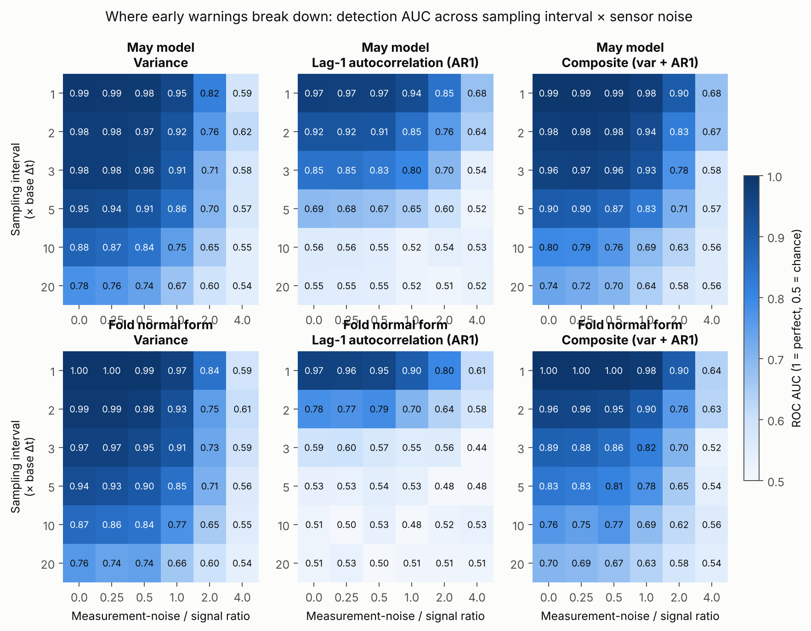
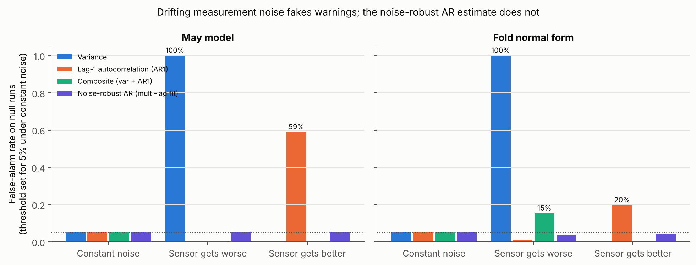

# Robustness of Early-Warning Indicators under Sparse and Noisy Observations

Independent research project · Python · time-series analysis · dynamical systems

**Question:** before a system "tips" (lake collapse, desertification, abrupt
climate shift), *critical slowing down* makes its fluctuations grow (rising
variance) and become more persistent (rising lag-1 autocorrelation). Do these
early-warning indicators still work when the data is sparse, gappy and noisy,
as real monitoring data usually is?

**Full write-up:** [`REPORT.md`](REPORT.md)

## Key findings (300 forced + 300 null runs per condition, 2 models)

| | Result |
|---|---|
| Sparse sampling | AR1 drops to chance once the sampling interval exceeds the recovery time (fold model, Δt = 5: AUC 0.53). Variance holds up (0.94). |
| Constant sensor noise | Costs little up to noise ≈ signal (AUC > 0.9). At 4× noise, every indicator is close to chance. |
| Fixed sampling budget | A long, sparse record beats a short, dense one (100 points: AUC 0.88 vs 0.56). |
| Random gaps | Variance is robust to 60% missing data. AR1 loses 0.2–0.3 AUC. |
| **Drifting sensor noise** | A degrading sensor gives a **100%** false-alarm rate for variance. An improving one gives **59%** for AR1. |
| **Mitigation** | A noise-robust AR estimator (ARMA(1,1)-style multi-lag fit) keeps false alarms at 5% under drift and recovers the true autocorrelation level. |




## Repository layout

```
ews/
  models.py       stochastic models approaching a fold bifurcation + null models
  degrade.py      subsampling, measurement noise (constant/drifting), random gaps
  indicators.py   detrending, NaN-aware rolling variance/AR1/skewness,
                  noise-robust AR estimators, Kendall tau
  evaluate.py     ROC AUC, detection rate at fixed false-alarm rate, bootstrap CI
run_experiments.py   experiments E1–E5 -> results/*.csv
make_figures.py      figures/*.png from the results
tests/               sanity tests (estimators recover known values)
REPORT.md            paper-style write-up
```

## Reproduce

```bash
pip install -r requirements.txt
python tests/test_indicators.py      # quick sanity checks
python run_experiments.py --quick    # ~30 s smoke test (40 replicates)
python run_experiments.py            # full run, ~3-5 min (300 replicates)
python make_figures.py               # regenerates figures/
```

All random seeds are fixed, so results are reproducible.

## References

Scheffer et al. 2009 (*Nature*); Dakos et al. 2008 (*PNAS*), 2012 (*PLoS ONE*);
Boettiger & Hastings 2012 (*J. R. Soc. Interface*); Bury et al. 2021 (*PNAS*).
