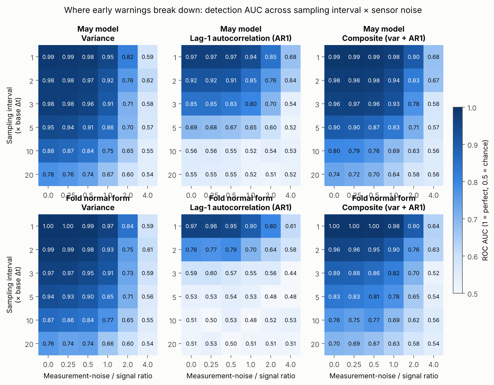
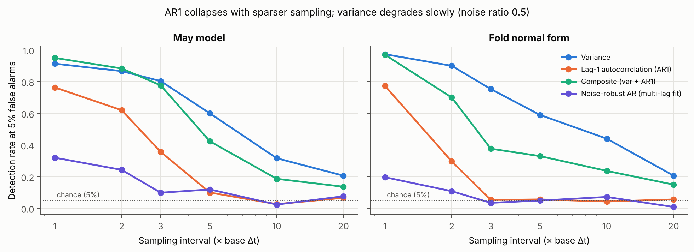
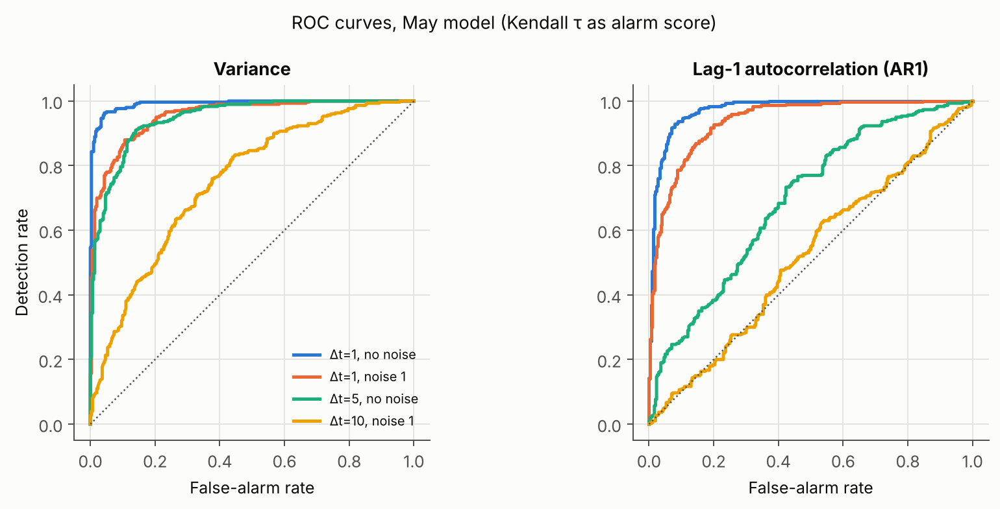
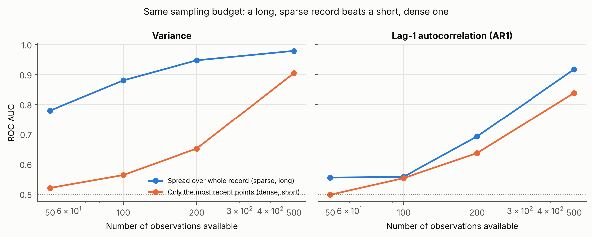
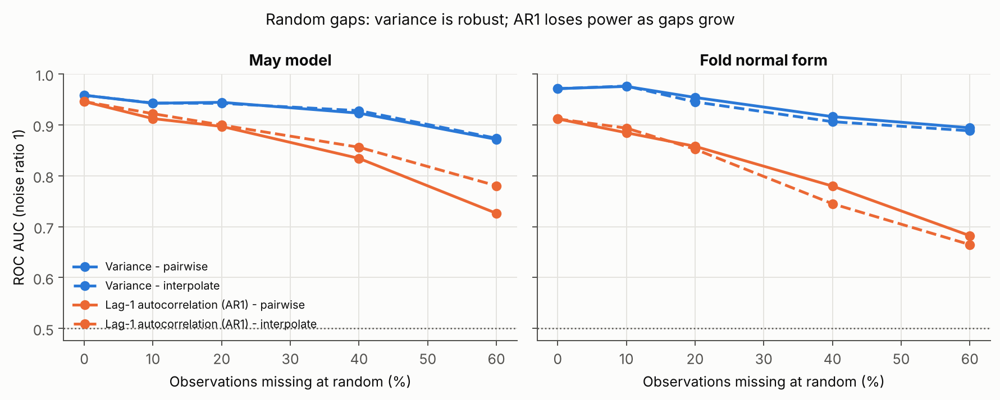
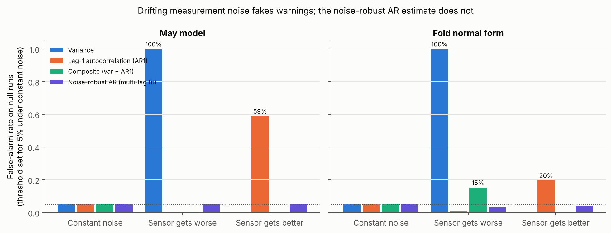
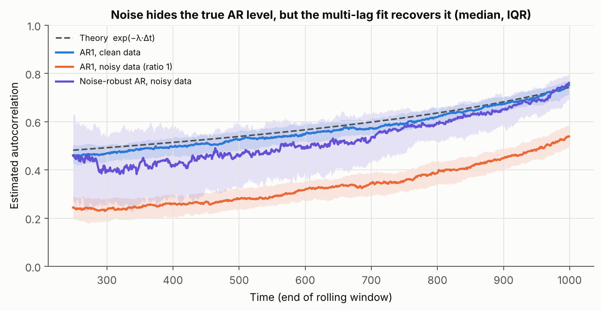
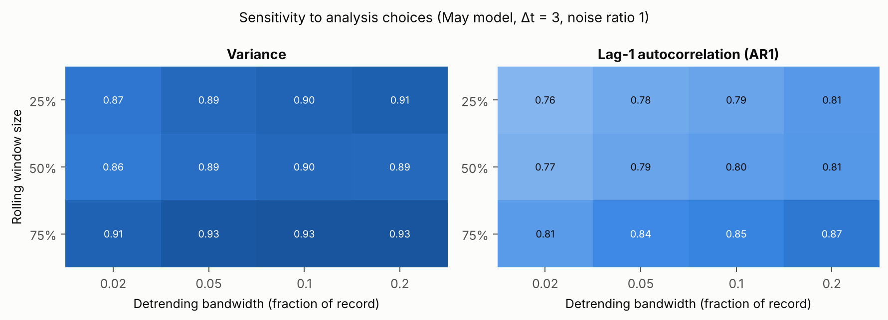

# Robustness of Early-Warning Indicators under Sparse and Noisy Observations

**Author:** Manya M (Basava Rajeshwari M Hakkandi) · Independent research · November 2026
**Code:** this repository (`ews/`, `run_experiments.py`, `make_figures.py`)

---

## Abstract

Rising variance and rising lag-1 autocorrelation (AR1) are the standard
early-warning indicators (EWIs) of an approaching critical transition. They come
from *critical slowing down*: near a bifurcation, a system recovers more and
more slowly from perturbations. Almost all evidence for these indicators comes
from clean, densely sampled simulations. This study measures how well they
survive realistic data problems: coarse sampling intervals, short records,
random gaps, and measurement noise that is either constant or drifting. The
test systems are two stochastic models that approach a fold bifurcation (the
May harvesting model and the saddle-node normal form), each paired with a null
model that never transitions. Each condition uses 300 replicates of each, and
detection is scored by ROC AUC.

There are four main findings.

1. **AR1 is much more fragile to sparse sampling than variance.** In the fold
   normal form, AR1 detection falls from AUC 0.97 to chance (0.53) once the
   sampling interval is 5× the base resolution. Variance keeps AUC 0.94 there.
2. **Constant measurement noise mostly reduces power. It does not create false
   alarms.** Both indicators stay above AUC 0.9 until the noise is as large as
   the true fluctuations.
3. **With a fixed sampling budget, a long sparse record beats a short dense
   one.** With 100 points, variance gives AUC 0.88 when the points are spread
   over the whole record, but only 0.56 when they are packed into the most
   recent stretch.
4. **Measurement noise that changes over time produces convincing false
   warnings.** A slowly degrading sensor made variance raise a false alarm in
   **100%** of null runs. An improving sensor did the same for AR1 in **59%** of
   null runs. A noise-robust AR estimator (an ARMA(1,1)-style multi-lag fit)
   held the false-alarm rate at its nominal 5% in every drift scenario, and it
   recovered the true autocorrelation level. The cost is lower detection power
   under constant noise.

---

## 1. Background

Many systems (lakes, vegetation, climate subsystems, physiological
rhythms) can shift abruptly between alternative stable states when a slowly
changing driver crosses a *tipping point* (a bifurcation). Near a fold
bifurcation, the stable state's recovery rate λ (the negative of the dominant
eigenvalue of the linearised dynamics) goes to zero. Locally, the system then
behaves like an AR(1) process:

  x(t+Δt) − x* ≈ e^(−λΔt) · (x(t) − x*) + noise

so, as λ → 0:

- **lag-1 autocorrelation** AR1 = e^(−λΔt) rises toward 1, and
- **variance** σ²/(2λ) rises toward infinity.

These two statistics, computed in a rolling window and tested for an upward
trend with Kendall's τ, are the classic EWIs (Scheffer et al. 2009; Dakos et
al. 2012).

**Why sparse and noisy data is a problem — the hypotheses tested here:**

- *Sampling interval.* AR1 depends on the product λΔt. If Δt is large compared
  with the recovery time 1/λ, AR1 is close to 0 throughout and its trend
  disappears. Variance does not depend on Δt, so it should be more robust.
- *Measurement (observation) noise* η adds to the variance and attenuates
  every autocorrelation by the factor A = σ²ₓ / (σ²ₓ + σ²_η). If η is
  constant, the trend may survive. If η drifts, it can fake a trend.
- *Gaps* reduce the number of usable lag-1 pairs. AR1 needs adjacent pairs;
  variance does not.

## 2. Methods

### 2.1 Models (Euler–Maruyama, dt = 0.01, observed every Δt₀ = 1, T = 1000)

| Model | Equation | Forcing (forced runs) | Null runs |
|---|---|---|---|
| May harvesting | dx = [x(1 − x/10) − c·x²/(x²+1)]dt + 0.15 dW | c: 1.0 → 2.55 (fold at c ≈ 2.604) | c = 1.0 fixed |
| Fold normal form | dx = (μ − x²)dt + 0.05 dW | μ: 1.0 → 0.05 | μ = 1.0 fixed |

Over the forced run, the recovery rate λ falls from 0.78 to 0.14 (May model)
and from 2.0 to 0.45 (fold normal form). At base resolution, the theoretical
AR1 therefore rises from 0.46 to 0.87 (May) and from 0.14 to 0.64 (fold).
Indicators were computed only on pre-transition data (series truncated at the
first crossing of x = 4 for May, x = −0.1 for the fold). In practice none of
the 1,200 runs tipped early.

### 2.2 Degradations

- **Sampling interval:** keep every k-th point, k ∈ {1, 2, 3, 5, 10, 20}. The
  record length stays the same, so n falls from 1000 to 50 points.
- **Measurement noise:** white Gaussian noise with standard deviation
  = r × (sd of the true detrended fluctuations), r ∈ {0, 0.25, 0.5, 1, 2, 4}.
  The same absolute noise is added to forced and null runs.
- **Fixed budget (E2):** n points either spread over the whole record ("sparse,
  long") or taken as the last n points at full resolution ("dense, short").
- **Random gaps (E3):** 0–60% of points removed at random. Two treatments are
  compared: NaN-aware *pairwise* statistics vs. *linear interpolation*.
- **Drifting noise (E5):** noise ratio rising linearly 0.25 → 1.75 ("sensor
  gets worse") or falling 1.75 → 0.25 ("sensor gets better"). The average is
  the same as the constant-noise (r = 1) case.

### 2.3 Indicators

The residuals came from Gaussian-kernel detrending (bandwidth = 5% of the
record). Statistics were computed in a rolling window of 50% of the record.
All rolling statistics use cumulative sums with explicit pair counts, so gaps
are handled exactly.

| Indicator | Definition |
|---|---|
| Variance | rolling variance of the residuals |
| AR1 | rolling lag-1 autocorrelation |
| Skewness | rolling third standardized moment |
| Composite | τ(variance) + τ(AR1): both trends must agree |
| Noise-robust AR, ρ₂/ρ₁ | ratio of lag-2 to lag-1 autocorrelation |
| **Noise-robust AR, multi-lag fit** | least-squares fit of ρ(k) = A·φᵏ for k = 1…4, with A free |

**Why the noise-robust estimators work.** If the true process is AR(1) with
coefficient φ and white measurement noise is added, the observed series is
ARMA(1,1). Its autocorrelations are ρ(k) = A·φᵏ for k ≥ 1, where A < 1 is the
attenuation caused by the noise. Fitting A and φ separately removes the noise
bias from φ. Using four lags instead of the simple ratio ρ₂/ρ₁ cuts the
estimator's spread considerably (Figure 8; unit tests in `tests/`).

### 2.4 Scoring

The trend statistic is Kendall's τ of each indicator against time. **Detection
performance** is the ROC AUC for separating forced runs from null runs by τ
(300 vs. 300). **Detection rate** is the fraction of forced runs flagged when
the threshold is set so that 5% of null runs give a false alarm. For drifting
noise, the false-alarm threshold is calibrated on constant-noise null runs, as
a practitioner would do. 95% confidence intervals come from bootstrapping
(300 resamples).

## 3. Results

### 3.1 Sampling interval × measurement noise (Figure 2, Figure 3)

| AUC (95% CI) | Δt = 1, no noise | Δt = 1, noise r = 1 | Δt = 5, no noise | Δt = 10, noise r = 1 |
|---|---|---|---|---|
| **May — variance** | 0.991 (0.986–0.996) | 0.955 (0.940–0.971) | 0.947 (0.931–0.963) | 0.750 (0.713–0.785) |
| **May — AR1** | 0.973 (0.961–0.984) | 0.938 (0.921–0.956) | 0.692 (0.653–0.736) | 0.520 (0.475–0.569) |
| **May — composite** | 0.992 (0.987–0.997) | 0.976 (0.966–0.986) | 0.901 (0.876–0.925) | 0.689 (0.644–0.726) |
| **Fold — variance** | 0.998 (0.996–0.999) | 0.968 (0.957–0.978) | 0.936 (0.916–0.956) | 0.775 (0.737–0.810) |
| **Fold — AR1** | 0.967 (0.954–0.978) | 0.900 (0.876–0.922) | 0.535 (0.490–0.578) | 0.480 (0.434–0.527) |
| **Fold — composite** | 0.997 (0.995–0.999) | 0.983 (0.976–0.990) | 0.834 (0.801–0.862) | 0.687 (0.645–0.729) |

- **AR1 loses its signal once λΔt is large.** This matches theory. In the fold
  model, AR1 = e^(−2·3) ≈ 0.002 at the start at Δt = 3, so there is almost no
  correlation left to rise. AUC is 0.59 there. In the May model, which has a
  slower recovery rate, AR1 lasts until roughly Δt = 3–5. A practical rule
  that follows: **sample at intervals shorter than the system's recovery time
  (Δt ≲ 1/λ) if you want to use AR1.**
- **Variance degrades gracefully.** Its loss of power at large Δt is mostly
  due to having fewer points (n = 50 at Δt = 20), not to the interval itself.
- **Measurement noise up to about the size of the true fluctuations (r ≤ 1)
  costs little.** At r ≥ 2 every indicator weakens sharply, and at r = 4 all
  are close to chance (AUC ≤ 0.68).
- **The composite is best only when both indicators work.** When AR1 is
  uninformative (sparse data), adding it dilutes the variance signal. The
  composite then falls below variance alone (for example, fold model at
  Δt = 5: 0.83 vs. 0.94).
- **Skewness was uninformative in every condition** (AUC 0.41–0.54). The fold
  bifurcation in these models does not produce a consistent skewness trend.

### 3.2 Fixed sampling budget (Figure 5)

| n points | Variance: sparse/long | Variance: dense/short | AR1: sparse/long | AR1: dense/short |
|---|---|---|---|---|
| 50 | 0.78 | 0.52 | 0.55 | 0.50 |
| 100 | 0.88 | 0.56 | 0.56 | 0.55 |
| 200 | 0.95 | 0.65 | 0.69 | 0.64 |
| 500 | 0.98 | 0.90 | 0.92 | 0.84 |

(May model, no measurement noise.) A long record captures a larger change in
λ, and that matters more than resolution. For a monitoring program with a
fixed budget, **spreading observations out over time is better than sampling
intensively for a short period.**

### 3.3 Random gaps (Figure 6)

Variance tolerates gaps well: at 60% missing and noise r = 1, AUC is still
0.87 (May) and 0.89 (fold). AR1 falls to 0.73 and 0.68. Pairwise statistics
and linear interpolation perform about the same (within ±0.05). Interpolation
helped AR1 slightly in the May model, probably because interpolation adds
artificial autocorrelation that grows with gap density. That is a warning that
gap-filling can change autocorrelation-based indicators.

### 3.4 Drifting measurement noise — false warnings (Figure 7)

| False-alarm rate (nominal 5%) | Constant | Sensor gets worse | Sensor gets better |
|---|---|---|---|
| May — variance | 5% | **100%** | 0% |
| May — AR1 | 5% | 0% | **59%** |
| May — composite | 5% | 0% | 0% |
| May — **noise-robust AR (fit)** | 5% | **5%** | **5%** |
| Fold — variance | 5% | **100%** | 0% |
| Fold — AR1 | 5% | 1% | **20%** |
| Fold — composite | 5% | 15% | 0% |
| Fold — **noise-robust AR (fit)** | 5% | **4%** | **4%** |

This is the most practically important result. If the measurement noise grows
(sensor ageing, a change of observer, a switch to a cheaper method), the noise
adds to the variance and produces a variance "warning" in **every** null run.
If the noise shrinks (an upgraded instrument), AR1 is attenuated less over
time, so it appears to rise, giving a spurious AR1 warning. The multi-lag
noise-robust estimator is unaffected in both directions, because noise only
changes the amplitude A and not φ.

### 3.5 Estimating the level, not just the trend (Figure 8)

With noise ratio 1, plain AR1 underestimates the true autocorrelation by about
half (≈ 0.25 vs. ≈ 0.48 at the start). The multi-lag fit tracks the
theoretical value e^(−λΔt) and the clean-data estimate. This matters whenever
the *value* is used, for example to estimate the recovery rate λ = −ln(AR1)/Δt
or the distance to the tipping point.

**The trade-off.** Under constant noise the noise-robust estimator has *lower*
detection AUC than plain AR1 (May model, Δt = 1, no noise: 0.84 vs. 0.97),
because fitting an extra parameter increases its variance. It is a
false-alarm-safe check, not a replacement.

### 3.6 Sensitivity to analysis choices (Figure 9)

On clean data, AUC changed by less than 0.03 across window sizes 25–75% and
bandwidths 2–20%. On degraded data (Δt = 3, r = 1), larger windows and wider
bandwidths helped: AR1 AUC went from 0.76 to 0.87 and variance from 0.86 to
0.93. The conclusions above do not depend on the default settings.

## 4. Practical recommendations

1. **Use variance as the main indicator for sparse data.** Use AR1 only when
   the sampling interval is shorter than the system's recovery time.
2. **Prefer long records to dense ones** when the sampling budget is fixed.
3. **Treat a variance warning with suspicion if the measurement process may
   have changed.** Check it with a noise-robust autocorrelation estimator
   (ARMA(1,1) or multi-lag fit) before acting on it.
4. **Report the noise-robust AR alongside the plain AR1.** If they disagree in
   trend, measurement noise is the likely cause.
5. **Do not fill gaps carelessly.** Interpolation changes autocorrelation.
   Pairwise (NaN-aware) estimators avoid that.

## 5. Limitations and future work

- Only fold (saddle-node) bifurcations were studied. Hopf and transcritical
  bifurcations give different signatures (for example, spectral changes in a
  Hopf).
- Measurement noise was white and Gaussian. Autocorrelated (red) noise would
  bias the multi-lag fit and needs a state-space model, such as a Kalman filter
  with a parameterised noise process.
- Gaps were random. Real gaps are often clustered (winter months, sensor
  outages).
- **A real-data case study is the next step.** Paleoclimate records before
  abrupt transitions (Dakos et al. 2008) are naturally sparse, irregular and
  noisy. The pipeline in `ews/indicators.py` accepts NaN-gapped series
  directly.
- A deep-learning EWS classifier (Bury et al. 2021) could be tested on the
  same degradation grid.

## References

- Scheffer, M. et al. (2009). Early-warning signals for critical transitions. *Nature* 461, 53–59.
- Dakos, V. et al. (2008). Slowing down as an early warning signal for abrupt climate change. *PNAS* 105, 14308–14312.
- Dakos, V. et al. (2012). Methods for detecting early warnings of critical transitions in time series illustrated using simulated ecological data. *PLoS ONE* 7, e41010.
- Boettiger, C. & Hastings, A. (2012). Quantifying limits to detection of early warning for critical transitions. *J. R. Soc. Interface* 9, 2527–2539.
- Bury, T. M. et al. (2021). Deep learning for early warning signals of tipping points. *PNAS* 118, e2106140118.
- May, R. M. (1977). Thresholds and breakpoints in ecosystems with a multiplicity of stable states. *Nature* 269, 471–477.
